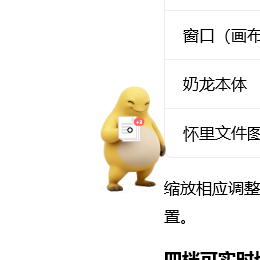
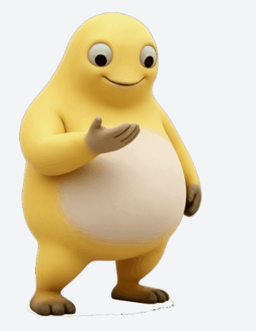
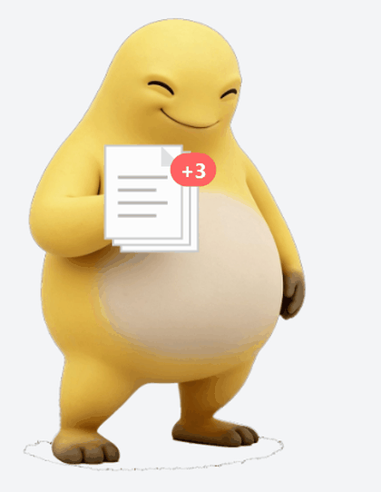
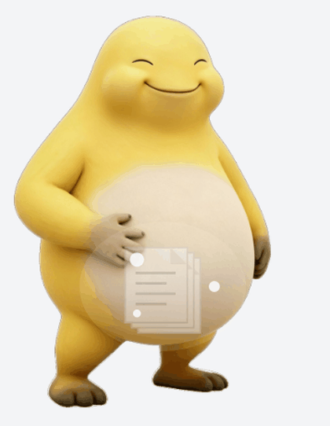
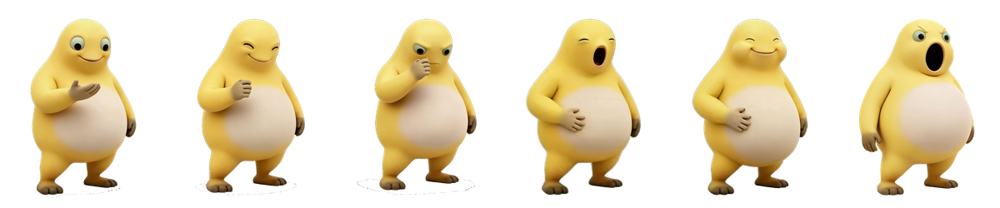
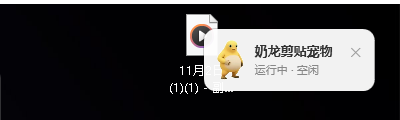
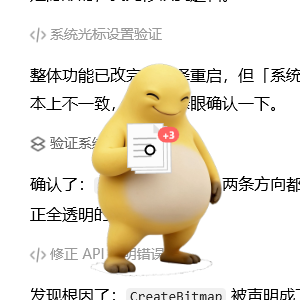
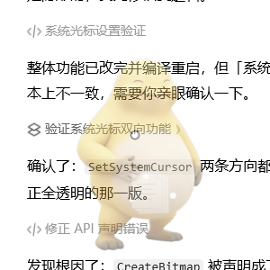

# 奶龙剪贴宠物 · NailongClipPet

> 你在 Windows 任何地方复制 / 剪切内容，鼠标立刻变成一只抱着东西的奶龙；粘贴时它当场放下或吐出来，然后消失。

纯 C# + WPF，**不用 Python、不用装运行库、不用 .NET SDK**，Win10/11 自带 .NET Framework 4.8 即可跑，
单个 exe 双击启动。

<p align="center"></p>

---

## 它长什么样、会做什么

| 你的操作 | 奶龙的表现 |
|---|---|
| `Ctrl+C` 复制文件 / 文件夹 | 抱着文件图标（多文件时右上角有 `+N` 角标），系统箭头消失、奶龙的手正好压在原光标位置 |
| `Ctrl+X` 剪切文件 / 文件夹 | 把文件塞进嘴里吞下去，肚子鼓起一收一缩，腹腔有流动光点，定时「咕咕」 |
| `Ctrl+C` 复制文字 | 抱着一张画了横线的小纸条 |
| `Ctrl+C` 复制图片 / 截图 | 抱着一张照片小样 |
| `Ctrl+V` 粘贴 | 复制 → 把东西放下；剪切 → 从肚子里吐出来。动画播完奶龙退场 |
| 右键菜单「粘贴」 | 同上，会放下 / 吐出来然后消失 |
| 按 `ESC` / 点别处 | 一愣，淡出消失 |
| 复制完一直不粘贴 | 12 秒后自动收起（可关） |

动作是 6 张姿势帧逐帧演的，不是一张图在飘：

- 复制：`<0.26s` 抬手空手（惊喜脸）→ 握物（得意脸），文件从手心「蹦」出来带回弹，之后一直抱着
- 剪切：握物 → 举到嘴边（用力脸）→ 塞进嘴（啊呜脸）→ 鼓肚（满足眯眼），腹腔亮光和光点
- 粘贴（复制）：把文件往下放到身前淡出 → 整体淡出
- 粘贴（剪切）：张嘴（使劲脸）→ 文件从嘴里冒出来放大 → 飞出去淡出

每帧表情都跟着动作一起换，所以看起来是「在表演」而不是「在漂」。

| 复制 | 剪切 |
|---|---|
|  |  |
|  |  |

<p align="center"><br><sub>六张姿势帧（a_handup / b_grip / c_mouth / d_open / e_big / f_bigopen）</sub></p>

---

## 安装

### 方式一：下载 Release（推荐）

1. 到 [Releases](../../releases) 下载最新的 `NailongClipPet.zip`
2. 解压到**任何可写目录**（例如 `D:\Tools\NailongClipPet`，**别放 `C:\Program Files`**，程序要在自己旁边写日志）
3. 双击 `NailongClipPet.exe`

结构必须是：

```
NailongClipPet.exe
Assets\art\nailong.png
Assets\art\anim\*.png     ← 6 张姿势帧
Assets\sounds\*.wav       ← 6 个音效
```

缺了 `Assets` 就只有声音没有形象（或反过来）。

### 方式二：自己编译（零依赖，不用装 VS / SDK）

```powershell
git clone <this repo>
cd NailongClipPet
powershell -ExecutionPolicy Bypass -File .\build.ps1
.\bin\NailongClipPet.exe
```

`build.ps1` 直接调用系统自带的 `C:\Windows\Microsoft.NET\Framework64\v4.0.30319\csc.exe` 编译
WPF 程序并自动把 `Assets` 拷到 `bin`，全程不联网、不装任何东西。

> 第一次运行 Windows 可能弹「已保护你的电脑」（SmartScreen）：因为 exe 没有代码签名，
> 而这个程序确实装了全局键鼠钩子、会临时替换鼠标指针、会监听剪贴板。
> 点「更多信息 → 仍要运行」即可。介意的话请自己看源码编译，或者加杀软白名单。

---

## 打开就能看到的东西

启动后常驻托盘，同时在**桌面右上角**出现一块小面板：

```
🐉 奶龙剪贴宠物        ✕
   运行中 · 空闲
```

- 宠物本体全透明且鼠标穿透，**这块面板是唯一「点得动」的窗口**
- 状态实时变：`空闲` / `抱着 3 个文件` / `肚子里装着 3 个文件` / `正在放下` / `正在吐出` / `正在收起`
- **点右上角 ✕ 退出整个程序**；面板可以按住拖动
- 重复双击 exe 不会再开第二只（单实例），而是把已有面板顶到最前

<p align="center"></p>

### 它是个「开才有、关就走」的普通程序

- 不写注册表、不建开机启动项、不装服务、不占任务栏；跑起来只有 `Assets`（素材）和 `debug.log`（日志）
- 关闭时按顺序收拾干净：停定时器 → 卸鼠标钩子 → 卸键盘钩子 → 停剪贴板 → 销毁窗口 →
  **无条件把系统箭头装回去** → 卸托盘 → 退出
- 被任务管理器强杀来不及还原箭头：下次启动第一件事就是把箭头修回来

### 托盘菜单

- 音效开关 / 剪切咕咕声 / 复制时用奶龙替代光标 / 无粘贴自动收起（12 秒）/ 奶龙大小（大·中·小·迷你）/ 退出

---

## 几个实现上值得一提的点

**1. 鼠标指针怎么「变成」奶龙**

`ShowCursor(false)` 会被别的窗口重置、60Hz `SetCursor` 只在本线程窗口生效，
最终用 `SetSystemCursor(透明光标, OCR_NORMAL)` 全局生效。透明光标做法：32×32、颜色 32bpp 全 0、
**掩码整片填 1**（掩码留 0 会画出黑方块）。`SetSystemCursor` 会接管并销毁传入句柄，所以每次都要新建。
恢复走注册表 `HKCU\Control Panel\Cursors\Arrow` + `LoadCursorFromFile`（`SPI_SETCURSORS` 实测无效），
并且只在「手里有东西」时隐藏，粘贴/取消一开始立刻还箭头。

<p align="center"></p>

**2. 右键菜单的「粘贴」抓不到怎么办**

Windows 不会给任何程序发「用户右键点了粘贴」的通知。这里用的是零延迟、纯坐标的启发式：
手里有东西时，**右键按下 → 8 秒内、600px 内出现左键按下** 就判定为点了菜单 → 播放释放动画。
不调 UIA（实测单次 73ms 会让光标发涩）。残余情况靠 12 秒兜底。

**3. 形象是抠像素来的，不是重画的**

从一张 3×4 的 12 姿势角色图里切片、四角泛洪去白底、只保留最大连通块（顺手剔掉旁边的说明文字），
再用 `005 单手摸腹` 这一格当基础造型。之后以它为基准只改手臂/嘴/肚子生成 6 张姿势帧，
统一归一化（角色等高、脚底基线对齐、水平居中），所以切帧不跳。

**4. 缩小不能裁腿**

用 `RenderTransform` 缩会把布局尺寸留原样、被小窗口裁掉下半身；改成给画布挂 `LayoutTransform`，
窗口尺寸和热点偏移按同一个 `Zoom` 同比换算，缩放后手依旧压在光标像素上。

---

## 已知限制（先知道，免得当 bug 提）

1. 拖拽粘贴、第三方软件自带菜单里的粘贴识别不到，只能靠 12 秒自动收起兜底
2. 第三方文件管理器（网盘客户端、解压软件、Total Commander 等）内部的复制剪切可能识别不到，或降级成「复制」；资源管理器与桌面是稳的
3. 在**管理员权限运行的程序**里复制时，普通权限的钩子收不到事件 → 不会触发
4. 替代光标只换 `OCR_NORMAL`（标准箭头）：文本框的 I 型光标、拖边角的双向箭头、链接小手仍会出现
5. 面板固定出现在**主屏**右上角
6. 任务管理器强杀会留下隐形箭头（下次启动自动修回）

---

## 目录结构

```
src\                     12 个源文件（Program / Types / NailongArt / PetCanvas / PetWindow /
                         ClipboardMonitor / KeyHook / MouseHook / Audio / Log / PetRuntime / Panel）
src\NailongArt.cs        形象与动作编排全在这里（切帧时间轴、怀里物品、肚子光点、曲线）
src\PetWindow.cs         悬浮窗口、跟随鼠标、热点、透明光标与恢复
src\PetRuntime.cs        状态机（复制持有 / 剪切持有 / 粘贴释放 / 取消）+ 面板状态
Assets\art\anim\         6 张姿势帧（900×1100 透明底）
Assets\art\nailong.png   基础造型（005 单手摸腹）
Assets\sounds\          6 个音效（复制啵 / 剪切啊呜 / 咕咕 / 落地咚 / 吐出噗 / 取消咻）
build.ps1                一键编译（系统自带 csc）
docs\                    截图与 GIF 预览
```

---

## 素材与版权（重要）

- **代码**：MIT，见 [LICENSE](LICENSE)
- **「奶龙」形象与名称**：属于其权利人，本项目里的姿势帧是从参考图抠出来 / 再改表情得到的，
  仓库仅作**技术演示与非商业学习**用途，**不随 MIT 授权**。若要商用或再分发素材，请自行取得授权。
  想完全规避风险的话：把 `Assets\art\anim\` 里 6 张图换成自己的角色（保持同名同尺寸即可，代码一行不用改）。
- 本项目不联网、不上传任何内容；剪贴板只读格式与本地路径，不写文件、不改你的任何数据。
